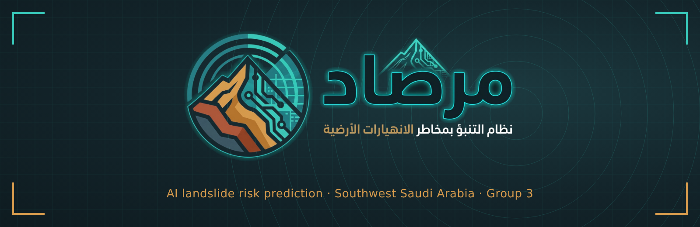
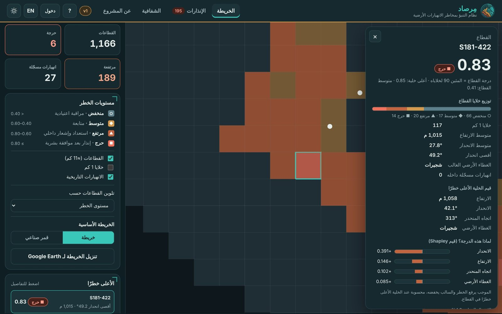
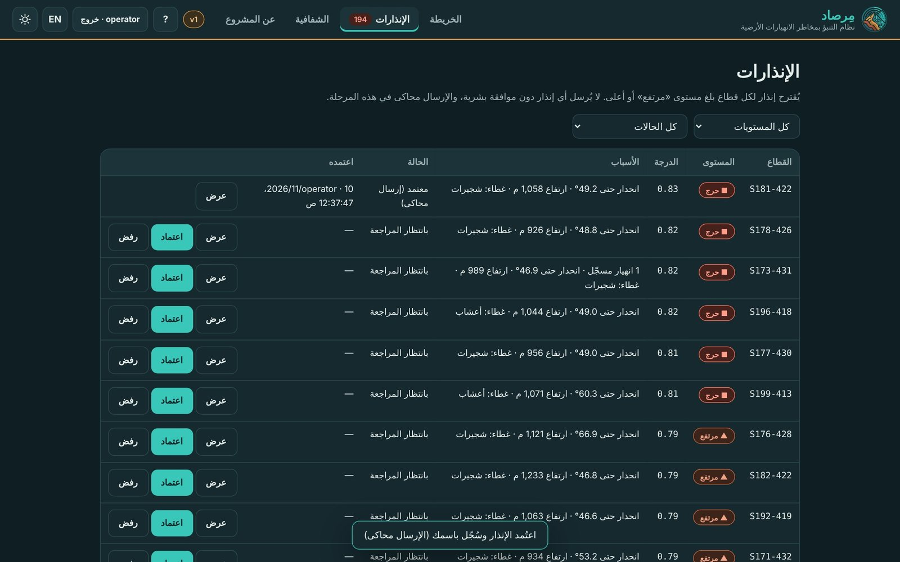
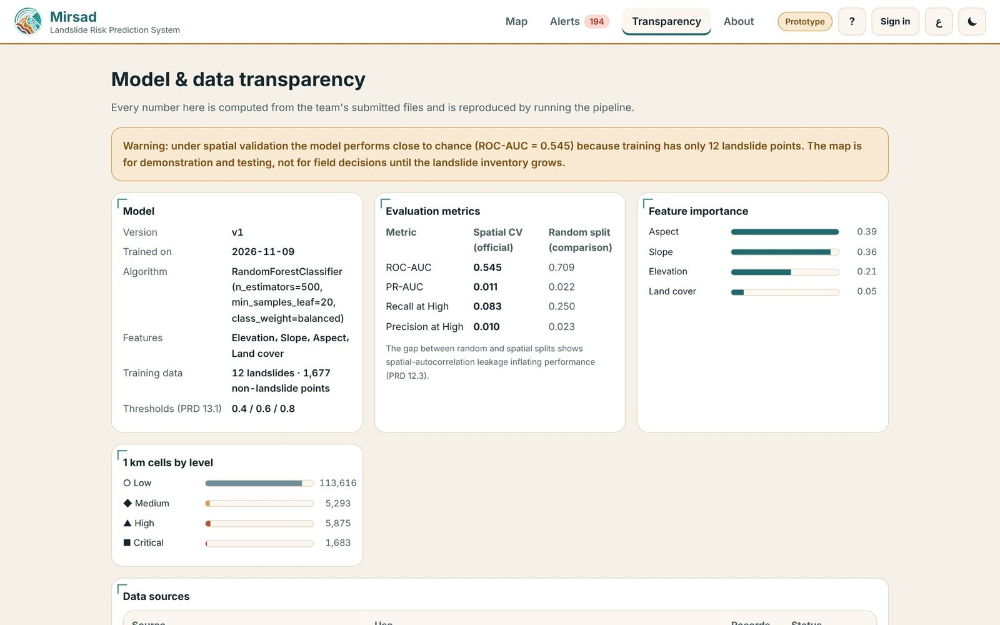
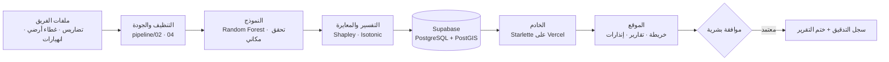
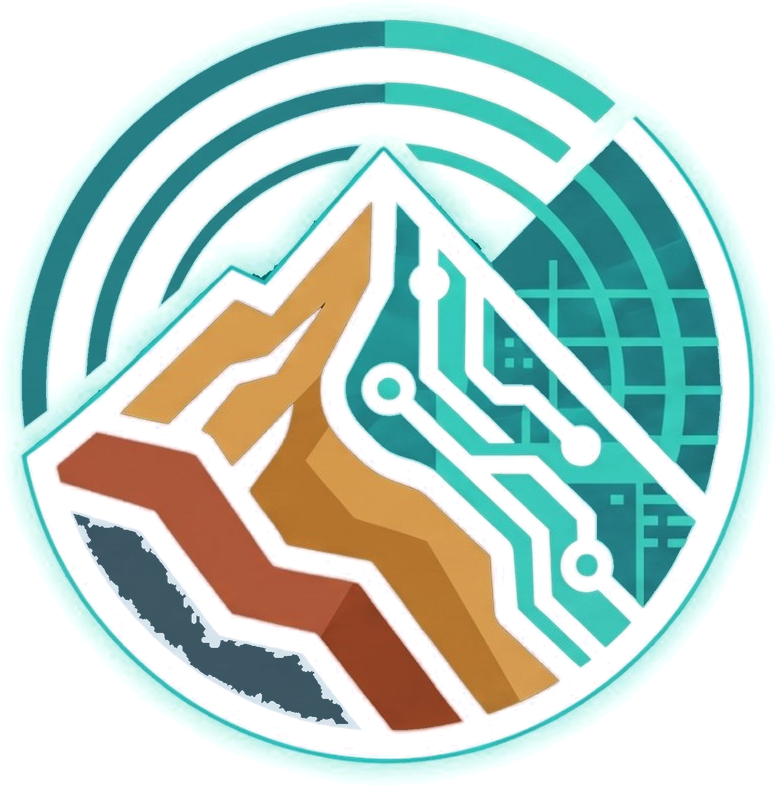

<p align="center">
  
</p>

<p align="center">
  <a href="https://mirsad-rho.vercel.app"></a>
  <a href="https://github.com/4-u1/Mirsad/actions/workflows/ci.yml"></a>
  
  
  <a href="LICENSE"></a>
</p>

<p align="center">
  <b><a href="https://mirsad-rho.vercel.app">🌐 الموقع</a></b> ·
  <b><a href="docs/Mirsad_Project_Report.pdf">📘 التقرير الشامل</a></b> ·
  <b><a href="docs/Mirsad_Introduction.pdf">📗 الدليل التعريفي</a></b> ·
  <a href="docs/user_guide.md">دليل المستخدم</a> ·
  <a href="docs/decisions.md">سجل القرارات</a> ·
  <a href="CHANGELOG.md">الإصدارات</a> ·
  <a href="docs/technical_report.md">التقرير الفني</a> ·
  <a href="docs/presentations/Mirsad_Presentation.pdf">🎞️ العرض التقديمي</a> ·
</p>

---

## نبذة

**مِرصاد** نظام ذكاء اصطناعي يقدّر قابلية الانهيارات الأرضية في جنوب غرب المملكة العربية السعودية (جازان، عسير، الباحة، نجران)، ويعرضها على خريطة قطاعات تفاعلية، ويقترح إنذارات **لا تُعتمد إلا بموافقة بشرية**. مشروع أكاديمي للقروب الثالث: 13 عضوًا في 4 مسارات.

> **Mirsad** estimates landslide susceptibility across southwest Saudi Arabia, maps it as an interactive sector map, and proposes alerts that only go out after a human approves them.

<table>
<tr>
<td align="center"><b>126,467</b><br><sub>خلية تنبؤ بحجم 1 كم</sub></td>
<td align="center"><b>1,166</b><br><sub>قطاعًا بحجم 11 كم</sub></td>
<td align="center"><b>195</b><br><sub>قطاعًا مرتفعًا أو حرجًا</sub></td>
<td align="center"><b>14 / 14</b><br><sub>اختبار ناجح</sub></td>
<td align="center"><b>5 / 5</b><br><sub>معايير القبول</sub></td>
</tr>
</table>

## لقطات من النظام

<table>
<tr>
<td width="50%"><p align="center"><sub>خريطة القطاعات بمستويات الخطر</sub></p></td>
<td width="50%"><p align="center"><sub>تفاصيل القطاع وأهم العوامل (Shapley)</sub></p></td>
</tr>
<tr>
<td width="50%"><p align="center"><sub>اعتماد إنذار بموافقة بشرية</sub></p></td>
<td width="50%"><p align="center"><sub>صفحة الشفافية · الوضع النهاري بالإنجليزية</sub></p></td>
</tr>
</table>

## كيف يعمل



## حالة المشروع

نسبة الإنجاز الفعلية **98%** من متطلبات الـPRD الوظيفية (26 متطلبًا، كل واحد مقيس بدليل)، و**97%** من متطلبات Must. المتبقي بشري: سجل انهيارات أكبر من هيئة المساحة الجيولوجية، ومراجعة الفريق للتوثيق. القرارات الفنية موثقة في [سجل القرارات](docs/decisions.md). التفصيل الكامل في [التقرير الشامل](docs/Mirsad_Project_Report.pdf).

| المجال | الإنجاز | المتبقي |
|---|:---:|---|
| البيانات | 93% | سجل انهيارات بمئات المواقع (طلب رسمي)، الخريطة الجيولوجية التفصيلية |
| قاعدة البيانات المكانية | 100% | — |
| الذكاء الاصطناعي | 100% | — (إعادة آلية عند وصول السجل) |
| الواجهة والتوثيق | 99% | مراجعة الفريق واعتماد القائد |

## النموذج بصراحة

| المقياس | تحقق مكاني | تقسيم عشوائي |
|---|:---:|:---:|
| ROC-AUC | **0.545** | 0.709 |
| PR-AUC | 0.011 | 0.022 |

**النموذج v2 بالبيانات العامة (أمطار، تربة، صخور، انحناء، تضرّس):** ROC-AUC المكاني **0.74** مقابل 0.545، وPR-AUC 0.017 مقابل 0.011،
لكن الاستدعاء عند «مرتفع» نزل من 0.083 إلى 0.0، فلم يحقق قاعدة الاعتماد المكتوبة قبل التدريب وبقي v1 ([ق-4](docs/decisions.md)).

> ⚠️ أداء النموذج في التحقق المكاني قريب من العشوائي لأن سجل التدريب فيه **12 نقطة انهيار فقط**. النظام مكتمل تقنيًا من البيانات إلى الإنذار، لكن الخريطة أداة دعم قرار أكاديمية وليست أساسًا لقرار ميداني. الأمطار والتربة والصخور معروضة على الخريطة ومستخدمة في التنبؤ، ولم تدخل النموذج المعتمد (ق-4). **التنبؤ 72 ساعة** قاعدة شفافة من توقعات الأمطار وعتبة كل قطاع، وليس نموذجًا مُعايَرًا بأحداث ([ق-5](docs/decisions.md)). **صور الأقمار الصناعية (Sentinel-2)** تُحلَّل أسبوعيًا: صورة حديثة فوق الخريطة ومؤشر تغيّر الغطاء النباتي لكل قطاع للمراجعة البشرية، ولا يغيّر مستوى الخطر ([ق-6](docs/decisions.md)).

## التقنيات

| الطبقة | التقنية |
|---|---|
| البيانات | Copernicus DEM 30 م · ESA WorldCover 2021 · NASA Global Landslide Catalog · USGS · CHIRPS v2.0 (أمطار) · SoilGrids 2.0 (تربة) · Macrostrat/BRGM (صخور) · Open-Meteo (توقعات) |
| خط المعالجة | Python · pandas · scikit-learn · TensorFlow (مقارنة الشبكة العصبية على GitHub Actions) |
| قاعدة البيانات | PostgreSQL + PostGIS على Supabase · SQLite محليًا |
| الخادم | Starlette على Vercel · أدوار مشاهد/مشغّل/مسؤول · سجل تدقيق |
| الواجهة | HTML/CSS/JS · MapLibre GL · خرائط Esri · عربي/إنجليزي · ليلي/نهاري |
| الأتمتة | GitHub Actions: اختبارات على SQLite وPostGIS · تحميل القاعدة · تشغيل أسبوعي · مقارنة TensorFlow · جلب البيانات العامة · تنبؤ كل 6 ساعات · فحص المتصفح على الموقع الحي |

## التشغيل

```bash
git clone https://github.com/4-u1/Mirsad.git && cd Mirsad
pip install -r requirements-pipeline.txt
export MIRSAD_ADMIN_PASSWORD='…' MIRSAD_OPERATOR_PASSWORD='…'
python pipeline/run_all.py              # تنظيف ← جودة ← تدريب ← تفسير ← Google Earth ← قاعدة البيانات
uvicorn backend.app:app --port 8000     # http://localhost:8000
pytest -q                               # 16 اختبارًا: AC-1..AC-5 والصلاحيات والتنبؤ والأقمار الصناعية وحفظ الاعتمادات
```

**الإنتاج:** الموقع والخادم على Vercel، والقاعدة على Supabase. تُحمَّل القاعدة من سير العمل `load-supabase.yml` بأسرار المستودع، ويُعاد خط المعالجة كاملًا كل أسبوع عبر `scheduled-run.yml`.

## هيكل المستودع

```
data/raw/          ملفات الفريق كما أُرسلت (بعد حذف 4 نسخ مكررة)
data/processed/    البيانات المنظفة + درجات الخطر + تقارير التنظيف والجودة + public/ (الطبقات العامة)
pipeline/          01 التضاريس (Colab) · 02 التنظيف · 03 التدريب · 04 الجودة · 05 التفسير · 06 Google Earth · 07 TensorFlow
                   08 جلب البيانات العامة · 09 مميزات v2 وقرار النموذج · 10 التنبؤ 72 ساعة · 11 صور Sentinel-2
model/             النموذج المدرّب، المعايرة، بطاقة النموذج
backend/           الخادم، مخطط PostGIS، تحميل البيانات، قواعد الإنذار
api/               مدخل الخادم على Vercel
web/               الموقع: الخريطة، الإنذارات، الشفافية، تقرير القطاع، الدليل التفاعلي
tests/             اختبارات القبول والصلاحيات
docs/              التقرير الشامل، الدليل التعريفي، دليل المستخدم، التقرير الفني، سجل القرارات، العرض التقديمي
docs/reference/    وثيقة المتطلبات PRD وهوية المشروع
docs/maps/         مشاريع QGIS والخرائط المصدّرة
```

## الفريق

**القروب الثالث** · 13 عضوًا · القائد: **مشاري العصيمي** · النائبة: **وجد الهذلي**

4 مسارات: البيانات الجيولوجية والمناخية · قاعدة البيانات المكانية (GIS) · نمذجة الذكاء الاصطناعي · واجهة الويب والتوثيق.

## المصادر والتراخيص

الكود تحت رخصة [MIT](LICENSE). البيانات: Copernicus DEM (رخصة Copernicus) · ESA WorldCover 2021 (CC BY 4.0) · USGS (ملكية عامة) · NASA Global Landslide Catalog · تقارير إخبارية مذكورة في `data/processed/landslide_inventory.csv`. الخرائط الأساسية وصور الأقمار الصناعية: Esri (HERE, Garmin, © OpenStreetMap contributors, Maxar).

<p align="center"><br><sub>مِرصاد · 2026</sub></p>
