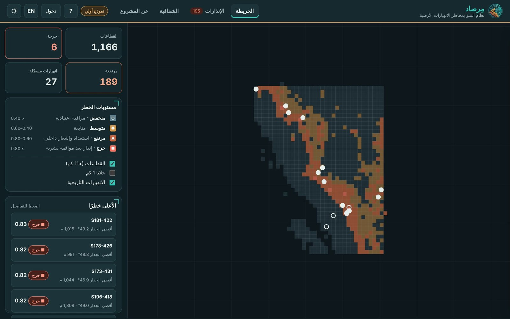

# مِرصاد · Mirsad

**نظام التنبؤ بمخاطر الانهيارات الأرضية** — مشروع أكاديمي (القروب الثالث) لتقدير قابلية الانهيارات الأرضية في جنوب غرب المملكة العربية السعودية، مع لوحة قيادة ثنائية اللغة وإنذار يمر بموافقة بشرية.

**Landslide risk prediction system** — an academic project (Group 3) estimating landslide susceptibility in southwest Saudi Arabia, with a bilingual dashboard and human-approved alerts.

> ⚠️ **حدود الدقة.** أداء النموذج في التحقق المكاني قريب من العشوائي (ROC-AUC ≈ 0.55) لأن سجل التدريب فيه 12 نقطة انهيار فقط. الخريطة للعرض والتجربة، وليست أساسًا لقرار ميداني.
> **Accuracy limits.** Spatial-CV ROC-AUC ≈ 0.55 with only 12 landslide points in training. Not for field decisions.

📄 **[تقرير المشروع التفصيلي (PDF)](docs/Mirsad_Project_Report.pdf)** · [التقرير الفني](docs/technical_report.md) · [دليل المستخدم](docs/user_guide.md)



## هيكل المستودع · Repository layout

```
data/raw/          ملفات الفريق كما أُرسلت (بعد حذف النسخ المكررة)
data/processed/    البيانات بعد التنظيف + درجات الخطر v1
pipeline/          01 التضاريس (Colab) · 02 التنظيف · 03 التدريب · 04 الجودة · 05 المقارنات والتفسير · 06 Google Earth · run_all
model/             النموذج المدرّب وبطاقة النموذج (المقاييس والإعدادات)
backend/           خادم API (Starlette) · SQLite · مخطط PostGIS · تحميل البيانات
tests/             اختبارات القبول والصلاحيات
web/               واجهة الموقع (HTML/CSS/JS ثابتة، عربي/إنجليزي، ليلي/نهاري)
docs/              PRD، التقرير الفني، دليل المستخدم، الهوية، خرائط QGIS
```

## التشغيل · Run

```bash
pip install -r requirements-pipeline.txt
python pipeline/run_all.py           # تنظيف ← جودة ← تدريب ← مقارنات وتفسير ← Google Earth ← قاعدة البيانات
uvicorn backend.app:app --port 8000  # API + الواجهة على http://localhost:8000
pytest -q                            # اختبارات القبول AC-1..AC-5 والصلاحيات
```

بدون خادم، مجلد `web/` يعمل وحده كموقع ثابت (وضع العرض)، وهذا ما ينشره GitHub Pages عبر `.github/workflows/pages.yml`.

`pipeline/01_extract_terrain_real.ipynb` يعمل على Google Colab ويستخرج الارتفاع والانحدار والاتجاه (Copernicus DEM 30m) والغطاء الأرضي (ESA WorldCover 2021).

## ما الذي تم في التنظيف · Cleaning

| الملف | الإجراء |
|---|---|
| `grid_points_1.csv`، `landslide_points_clean_2.csv`، `All_Saudi_Rainfall_Combined_Final_1.xlsx`، نسخة `grid_points.qmd` الثانية | نسخ مطابقة بايت ببايت، حُذفت |
| `All_Saudi_Rainfall_Combined_Final.xlsx` | كان يدمج جدولين مختلفين في ورقة واحدة؛ فُصل إلى `rainfall_monthly_by_region.csv` و`conditioning_factors_282.csv` |
| سجل الانهيارات | دُمجت تفاصيل NASA GLC (المحفّز، الحجم، الوفيات)، ووُسمت النقاط التقريبية (25–50 كم) بأنها غير صالحة لاستخراج التضاريس |
| `risk_scores.csv` | استُخدمت خصائص الخلايا فقط؛ الدرجة والمستوى القديمان استُبدلا بتنبؤ النموذج v1 وعتبات الـPRD |

التقرير الكامل: `data/processed/cleaning_report.json`.

## النموذج · Model v1

- **الخوارزمية:** Random Forest (500 شجرة، `min_samples_leaf=20`، أوزان فئات متوازنة) — النموذج الأساسي في PRD (A-FR2).
- **المميزات:** الارتفاع، الانحدار، اتجاه المنحدر، الغطاء الأرضي — نفس مميزات جدول تدريب الفريق.
- **التقييم:** تحقق متقاطع مكاني بكتل 0.5° (PRD A-FR4)، مع تقسيم عشوائي للمقارنة فقط.
- **المستويات:** عتبات الـPRD 13.1: منخفض < 0.40 ≤ متوسط < 0.60 ≤ مرتفع < 0.80 ≤ حرج.
- **القطاع:** خلية 0.1° (≈11 كم)، ودرجته = المئين 90 لدرجات خلاياه.

| المقياس | تحقق مكاني | تقسيم عشوائي |
|---|---|---|
| ROC-AUC | 0.545 | 0.709 |
| PR-AUC | 0.011 | 0.022 |

## الحدود المعروفة · Known limitations

1. 12 نقطة انهيار فقط في التدريب مقابل 1,677 نقطة بدون انهيار.
2. الأمطار لم تدخل النموذج: 24 من 30 منطقة في ملف الأمطار إحداثياتها مؤقتة (24°، 45°).
3. الزلازل لم تدخل النموذج: لا يوجد أي زلزال من الـ140 في كتالوج USGS داخل منطقة الدراسة.
4. لذلك المخرج **قابلية مكانية ثابتة** وليس تنبؤًا زمنيًا (توقع 24/48/72 ساعة غير متاح).
5. الشبكة بتباعد ≈1 كم، والدرجات تغطي 126,467 من 176,266 خلية.
6. النقطة `NEWS_5` في جدول التدريب وغير موجودة في سجل الانهيارات النظيف.
7. مشروع QGIS `Mirsad_Landslide_Risk.qgz` يحتاج `mirsad_layers.gpkg` بجانبه، وهذا الملف غير موجود في المستودع.

## الواجهة · Web

شاشة تحميل بهوية المشروع، ودليل تفاعلي من 9 خطوات يُعرض أول مرة ويُعاد من زر «؟».


خريطة القطاعات وخلايا 1 كم والانهيارات التاريخية، درج تفاصيل لكل قطاع، صفحة إنذارات بموافقة بشرية (الإرسال محاكى، والسجل محفوظ في متصفح المستخدم)، صفحة شفافية بالمقاييس والمصادر والحدود. عربي/إنجليزي ووضع ليلي/نهاري بألوان الهوية، وكل أزواج النص والخلفية بتباين ≥ 4.5:1.

الخريطة الأساسية: © OpenStreetMap contributors © CARTO. البيانات: Copernicus DEM، ESA WorldCover 2021، USGS، NASA Global Landslide Catalog، تقارير إخبارية.

## الخادم · Backend API (PRD 15.2)

| الطريقة | المسار | الصلاحية |
|---|---|---|
| GET | `/api/v1/risk?level=&bbox=` | عامة |
| GET | `/api/v1/sectors/{id}` | عامة |
| GET | `/api/v1/sectors/{id}/forecast` | عامة — يرجع 501: لا توجد بيانات توقع |
| GET | `/api/v1/alerts?level=&status=&from=&to=` | عامة |
| POST | `/api/v1/alerts` `{alert_id|sector_id, action}` | مشغّل |
| GET | `/api/v1/model/runs/latest` · `/api/v1/sources` | عامة |
| GET/PUT | `/api/v1/settings/thresholds` | PUT للمسؤول |
| GET | `/api/v1/audit` | مسؤول |
| POST | `/api/v1/auth/login` | — |

مبني على Starlette (الإطار الذي بُني عليه FastAPI) لأنه ما كان متاحًا في بيئة البناء تثبيت FastAPI؛ المسارات والعقد مطابقة للـPRD. التخزين SQLite للتشغيل المحلي، ومخطط PostGIS المكافئ في `backend/schema_postgis.sql` (غير مختبر على خادم PostGIS).

التفاصيل: [التقرير الفني](docs/technical_report.md) · [دليل المستخدم](docs/user_guide.md)

## Google Earth

`web/data/mirsad_google_earth.kmz`: القطاعات ملوّنة بالمستوى، الانهيارات التاريخية، وحدود منطقة الدراسة. افتحه في Google Earth Pro أو Google Earth Web (Projects ← Import KML). ومن تفاصيل أي قطاع في الموقع زر «عرض في Google Earth».
